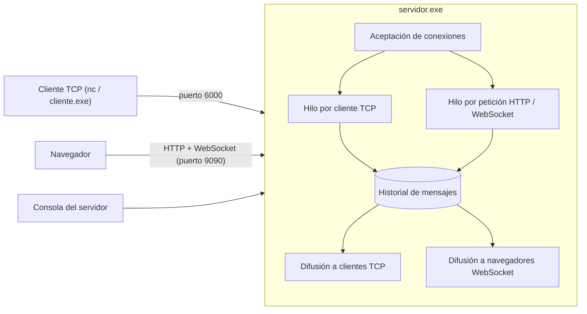

# winsock-chat-server

Servidor de chat **concurrente** escrito en **C puro** para Windows (WinSock2 + hilos Win32). Atiende clientes TCP, sirve una página web por HTTP y habla **WebSocket (RFC 6455)** con una implementación hecha a mano: handshake con SHA-1 y Base64, y lectura de tramas enmascaradas, sin librerías externas.

Un mensaje escrito desde cualquier punto (terminal TCP, navegador o consola del servidor) llega al instante a todos los demás.

## Características

- **Servidor multihilo:** un hilo por cada conexión TCP y por cada petición HTTP.
- **Chat TCP** en el puerto `6000`: se usa con `nc` o con el cliente incluido.
- **Servidor HTTP embebido** en el puerto `9090`, sin dependencias.
- **WebSocket implementado desde cero** (`websocket.h`): SHA-1, Base64, handshake y desenmascarado de tramas.
- **Historial** en memoria de los últimos 200 mensajes, consultable por la web.
- **Sincronización** con secciones críticas de Win32 y orden fijo de candados para evitar deadlocks.
- **Respaldo automático:** si el WebSocket se cae, la página vuelve a consultar por HTTP y reintenta conectarse.

## Arquitectura



Todo mensaje, venga de donde venga, pasa por una única función que lo guarda en el historial y lo reparte a los clientes TCP y a los navegadores conectados por WebSocket.

### Concurrencia

| Recurso compartido | Candado | Qué protege |
| :--- | :--- | :--- |
| Historial de mensajes | `lockMsgs` | `historial[]`, contador e identificadores |
| Clientes TCP | `lockClients` | Lista de sockets TCP conectados |
| Navegadores WebSocket | `lockWs` | Lista de sockets WebSocket y **todos** los `send()` hacia ellos |

Cuando se necesitan dos candados a la vez, siempre se toman en el mismo orden (`lockMsgs` primero, `lockWs` después). Eso evita que dos hilos queden esperándose mutuamente. Los `send()` a los WebSocket van dentro del candado para que dos hilos no mezclen bytes de dos tramas distintas en el mismo socket.

## Interfaz HTTP

| Método y ruta | Descripción |
| :--- | :--- |
| `GET /` | Devuelve la página del chat (`index.html`) |
| `GET /mensajes` | Historial de mensajes en JSON |
| `POST /enviar` | Publica un mensaje: `{"usuario":"...","texto":"..."}` |
| `GET /ws` | Pasa a WebSocket y empuja cada mensaje nuevo al navegador |

Los mensajes se intercambian como JSON:

```json
{"id": 2, "hora": "18:49:14", "origen": "TCP", "usuario": "Ana", "texto": "hola"}
```

`origen` indica de dónde vino el mensaje: `TCP`, `WEB` o `ADMIN` (consola del servidor).

## WebSocket a mano

El archivo [`src/websocket.h`](src/websocket.h) contiene funciones puras, sin sockets, fáciles de probar por separado:

| Función | Qué hace |
| :--- | :--- |
| `Sha1()` | Hash SHA-1 (RFC 3174) |
| `Base64Encode()` | Codificación Base64 |
| `WsAcceptKey()` | `Sec-WebSocket-Key` → `Sec-WebSocket-Accept` (`Base64(SHA1(clave + GUID))`) |
| `WsDecodeFrame()` | Lee una trama del navegador y quita la máscara (`byte ^ máscara[i % 4]`) |
| `WsEncodeFrame()` | Arma una trama del servidor, sin máscara |

Se validó con los ejemplos del RFC 6455; por ejemplo, la clave `dGhlIHNhbXBsZSBub25jZQ==` produce `s3pPLMBiTxaQ9kYGzzhZRbK+xOo=`.

Medidas de protección: el servidor exige la máscara en las tramas del cliente, rechaza tramas de más de 4 KB, no acepta fragmentación, limita los navegadores simultáneos, y usa tiempo máximo de envío y keep-alive para detectar clientes caídos.

## Requisitos

- Windows
- Compilador `gcc` de MinGW-w64 (por ejemplo, desde MSYS2)
- Opcional: `nc` (Ncat) para probar el chat por TCP

## Compilar

```powershell
cd src
gcc servidor.c -o servidor.exe -lws2_32
gcc cliente.c  -o cliente.exe  -lws2_32
```

## Uso

1. Inicia el servidor desde la carpeta `src` (necesita `index.html` en el mismo directorio):
   ```powershell
   .\servidor.exe
   ```
2. Abre el chat en el navegador: <http://localhost:9090>
3. Conéctate por TCP con cualquiera de estas dos formas:
   ```powershell
   nc localhost 6000
   .\cliente.exe
   ```
   El cliente también acepta la IP del servidor: `.\cliente.exe 192.168.1.20`.
4. Escribe en cualquier lado: el mensaje aparece en todos. Lo que escribas en la consola del servidor se difunde con el nombre `Consola`.

### Comprobar el WebSocket

Abre el chat, pulsa `F12` y entra en **Network**. Filtra por **WS** (en algunos navegadores se llama **Socket**) y recarga con `F5`: debe aparecer `ws` con estado `101`. En la pestaña **Messages** verás las tramas que van y vienen.

### Acceso desde otra red

Para probarlo desde Internet sin abrir puertos en el router, puedes exponer el puerto `9090` con un túnel, por ejemplo con Cloudflare Tunnel:

```powershell
cloudflared tunnel --url http://localhost:9090
```

La página detecta `https` y usa `wss://` automáticamente.

## Estructura

```
src/
├── servidor.c     Servidor multihilo: chat TCP, HTTP y WebSocket
├── websocket.h    SHA-1, Base64, handshake y tramas (RFC 6455)
├── cliente.c      Cliente TCP de consola
└── index.html     Interfaz web del chat
```

## Límites y seguridad

Es un proyecto de aprendizaje y no está pensado para producción:

- No hay autenticación: cualquiera que alcance el servidor puede escribir en el chat.
- No hay cifrado propio; para `wss://` hace falta un túnel o proxy inverso que termine TLS.
- El historial vive en memoria y se pierde al cerrar el servidor.
- Límites: 10 clientes TCP, 20 navegadores WebSocket, 200 mensajes de historial, 512 caracteres por mensaje.

## Qué aprendí construyéndolo

- Programación con la API de Windows: hilos, secciones críticas y WinSock2.
- Diseño de un servidor concurrente y prevención de condiciones de carrera y deadlocks.
- Un protocolo de red implementado desde la especificación (HTTP y RFC 6455), incluida la criptografía básica del handshake.
